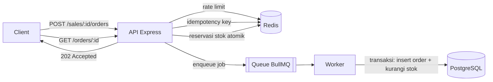

# Flash Sale Backend: Kerangka Arsitektur

Kerangka (scaffold) project backend flash sale. Struktur folder, tanggung jawab tiap file, dependency, dan
konfigurasi infrastruktur sudah disiapkan. **Logikanya sengaja kosong**: setiap file berisi komentar tentang
perannya dan daftar `TODO` yang perlu Anda implementasikan.

**Stack:** Node.js · Express · PostgreSQL · Redis · BullMQ · Docker · k6

## Masalah yang diselesaikan

Stok terbatas (misalnya 100), tetapi ribuan pengguna menekan "beli" bersamaan.
Hasil yang benar: **tepat 100 order sukses, tidak ada oversell, tidak ada pembelian ganda**, dan API tetap responsif.

## Arsitektur



**Alur pembelian**

1. Rate limit per user
2. Cek `Idempotency-Key`
3. Reservasi stok di Redis (operasi atomik); stok habis atau sudah pernah beli ditolak cepat
4. Job masuk queue, API membalas `202` + `orderId`
5. Worker menulis order dan mengurangi stok dalam satu transaksi PostgreSQL
6. Gagal permanen: reservasi di Redis dikembalikan (kompensasi)

**Tiga lapis pertahanan anti-oversell:** Redis atomik, `UPDATE ... WHERE remaining_stock > 0`, lalu constraint `CHECK` di database.

## Aturan dependensi antar lapisan

```
routes -> controllers -> services -> repositories -> database
```

- **routes**: mendefinisikan URL dan memasang middleware
- **controllers**: HTTP saja (baca `req`, tulis `res`), tanpa logika bisnis
- **services**: logika bisnis, tidak tahu Express
- **repositories**: satu-satunya tempat SQL ditulis
- Lapisan hanya boleh memanggil lapisan di bawahnya, tidak boleh melompat atau naik.

## Struktur folder

```
backend/
├── migrations/           # skema SQL
├── loadtest/             # skenario k6
├── docs/                 # dokumentasi, hasil EXPLAIN, hasil benchmark
├── src/
│   ├── config/           # env, logger, koneksi Postgres & Redis (+ Lua script)
│   ├── constants/        # status HTTP, role, nama queue, key Redis
│   ├── routes/           # definisi endpoint
│   ├── controllers/      # lapisan HTTP
│   ├── services/         # logika bisnis (inti: order.service.js)
│   ├── repositories/     # query SQL
│   ├── models/           # mapper baris DB -> JSON API
│   ├── middleware/       # auth, validasi, rate limit, idempotency, error, logging, metrics
│   ├── validators/       # skema Joi
│   ├── utils/            # helper: error, backoff, retry, pagination, cache, jwt, metrics
│   ├── jobs/             # queue (producer) dan worker (consumer) BullMQ
│   ├── scripts/          # migrate, seed, pembuat data load test, verifikasi
│   ├── app.js            # merakit Express (tanpa listen)
│   ├── server.js         # entry point API
│   └── worker.js         # entry point worker
└── tests/
    ├── unit/
    └── integration/
```

## Pemetaan konsep ke file

| Konsep | Dikerjakan di |
|---|---|
| Indexes | `migrations/001_init.sql` (buktikan dengan `EXPLAIN ANALYZE`) |
| Transactions & Isolation | `config/db.js` (`withTransaction`), `services/order.service.js` (`persistOrder`) |
| Idempotency Keys | `middleware/idempotency.middleware.js` |
| Connection Pooling | `config/db.js` |
| Caching & TTL | `utils/cache.js`, `services/product.service.js` |
| Message Queues | `jobs/queue.js`, `jobs/order.worker.js`, `worker.js` |
| Rate Limiting | `config/redis.js` (Lua `takeToken`), `middleware/rateLimit.middleware.js` |
| Auth | `services/auth.service.js`, `utils/tokens.js`, `middleware/auth.middleware.js` |
| Pagination | `utils/pagination.js` + query di `repositories/` |
| Timeouts & Retries | `utils/backoff.js`, `utils/retry.js`, `server.js`, `config/db.js` |
| Logs, Metrics, Traces | `config/logger.js`, `utils/metrics.js`, `middleware/requestLogger` dan `metrics` |
| Docker | `Dockerfile`, `docker-compose.yml` |

## Urutan pengerjaan yang disarankan

Setiap tahap bisa dijalankan dan dites sebelum lanjut ke tahap berikutnya.

- [ ] **1. Fondasi:** `config/*`, `constants/*`, `utils/ApiError`, `asyncHandler`, `app.js`, `server.js`, `/health`
- [ ] **2. Database:** `migrations/001_init.sql`, `scripts/migrate.js`, `/ready`
- [ ] **3. Auth:** validators, user repository, `auth.service`, `tokens`, middleware auth, rute auth
- [ ] **4. Katalog:** produk (CRUD admin), `pagination.js`, `cache.js`
- [ ] **5. Flash sale:** sale repository dan service, stok awal di Redis
- [ ] **6. Inti pembelian:** `reserveStock` (Lua), `order.service.placeOrder`, `idempotency`, endpoint beli
- [ ] **7. Asinkron:** `queue.js`, `order.worker.js`, `persistOrder` (transaksi), kompensasi, retry dengan backoff
- [ ] **8. Proteksi:** rate limiting (token bucket)
- [ ] **9. Observability:** logger + request id, metrics, `/metrics`
- [ ] **10. Pembuktian:** test integrasi oversell, load test k6, `verify-sale.js`, isi tabel benchmark
- [ ] **11. Docker:** `Dockerfile` dan `docker-compose.yml`

## Menjalankan

```bash
npm install
cp .env.example .env
docker compose -f docker-compose.dev.yml up -d   # Postgres + Redis
npm run migrate
npm run dev            # terminal 1: API
npm run dev:worker     # terminal 2: worker (sejak tahap 7)
```

## Definisi selesai

- [ ] Test integrasi: 300 pembeli rebutan 40 stok menghasilkan tepat 40 order
- [ ] Load test k6: ribuan request, 0 oversell (`npm run verify:sale` lolos)
- [ ] `docker compose up` menjalankan seluruh stack
- [ ] Tabel benchmark di bawah terisi hasil asli Anda
- [ ] README menjelaskan keputusan desain dan alasannya

## Hasil benchmark

| Skenario | Stok | Request | Order sukses | Oversell | p95 latency |
|---|---|---|---|---|---|
| | | | | | |

## Keputusan desain

Catat keputusan Anda di sini beserta alasannya, misalnya: kenapa rate limiter fail-open atau fail-closed,
kenapa Redis di depan tetapi PostgreSQL tetap sumber kebenaran, dan kenapa `READ COMMITTED` sudah cukup.
